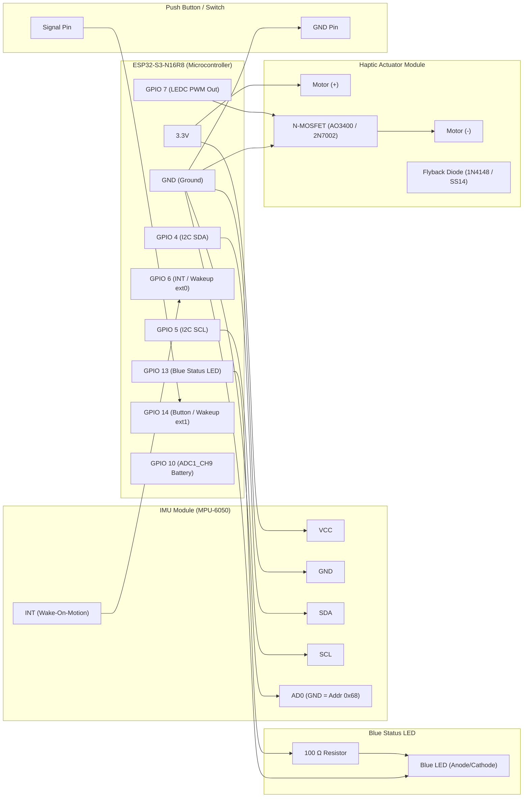

# health-kicks-esp32-s3: Connected Shoe Embedded Firmware

This repository contains the unified firmware for the **HealthKicks** connected shoe, designed for the **ESP32-S3-N16R8** microcontroller (16 MB Quad/Octal Flash, 8 MB Octal PSRAM). It replaces the legacy hybrid Raspberry Pi + Arduino Nano architecture.

---

## 1. Hardware Pinout & Wiring (ESP32-S3-N16R8)

### A. Critical Warning: Octal SPI Memory (N16R8)
> [!CAUTION]
> On ESP32-S3 modules equipped with Octal PSRAM and Flash (N16R8), pins **GPIO 33, 34, 35, 36, and 37** are hardwired internally to the Octal SPI memory bus.
> **DO NOT USE THESE PINS AS GENERAL PURPOSE GPIOS UNDER ANY CIRCUMSTANCES.** Connecting external signals to these pins causes bus corruption and immediate CPU crash/panics.

### B. Pinout Summary Table

| Component | Component Pin | ESP32-S3 Pin | Type / Function | Notes |
| :--- | :--- | :--- | :--- | :--- |
| **MPU-6050 (IMU)** | VCC | 3V3 | Power | Regulated 3.3V |
| **MPU-6050 (IMU)** | GND | GND | Ground | Common ground |
| **MPU-6050 (IMU)** | **SDA** | **GPIO 4** | I2C Data (RTC IO 4) | 4.7 kΩ pull-up to 3.3V |
| **MPU-6050 (IMU)** | **SCL** | **GPIO 5** | I2C Clock (RTC IO 5) | I2C Fast Mode 400 kHz, 4.7 kΩ pull-up |
| **MPU-6050 (IMU)** | AD0 | GND | I2C Address | Sets I2C address to `0x68` |
| **MPU-6050 (IMU)** | INT | **GPIO 6** | GPIO Interrupt | Optional (Wake-on-motion) |
| **Haptic Motor** | Gate (MOSFET) | **GPIO 7** | LEDC PWM (0-255) | 10 kHz frequency, Timer 0 |
| **Blue Status LED** | Anode (+ R 100 Ω)| **GPIO 13** | Output (Active High) | BLE (pairing/connected/disconnected), Calibration, Studio |
| **Pairing Button** | Contact | **GPIO 14** | RTC IO 14 (Input) | Internal pull-up, active low (GND), `ext1` wakeup |
| **RGB Status LED** | Data In | **GPIO 48** | RMT / WS2812 | Onboard RGB LED on DevKitC-1 |
| **Battery Sense** | Divider $V_{bat}$ | **GPIO 10** | ADC1_CH9 | 2x 100 kΩ divider ($V_{bat}/2$) |
| **Octal Flash/PSRAM**| - | **GPIO 33 to 37** | **PROHIBITED** | **Dedicated to Flash & Octal SPI PSRAM** |
| **Strapping Pins** | - | **GPIO 0, 45, 46** | Boot Strapping | Do not connect external load |
| **Native USB CDC** | USB D- / D+ | **GPIO 19, 20** | USB CDC/JTAG | Serial monitor & flash |

### C. Overall System Interconnection Diagram



### D. Detailed Component Wiring Schematics

```text
==================================================================================================
                              COMPLETE WIRING SCHEMATIC - ESP32-S3
==================================================================================================

1. IMU MODULE (MPU-6050) - I2C BUS AND WOM INTERRUPT
--------------------------------------------------------------------------------------------------
   ESP32-S3                                                MPU-6050 Module
  +-----------+                                           +---------------+
  |      3.3V |------------------------------------------>| VCC           |
  |       GND |-------------------+---------------------->| GND           |
  |           |                   |                       | AD0           | (GND = Addr 0x68)
  |           |       3.3V        |                       |               |
  |           |        |          |                       |               |
  |           |       [4.7k]      |                       |               | (I2C Pull-up resistor)
  |    GPIO 4 |--------+--------------------------------->| SDA           |
  |           |        |                                  |               |
  |           |       3.3V                                |               |
  |           |        |                                  |               |
  |           |       [4.7k]                              |               | (I2C Pull-up resistor)
  |    GPIO 5 |--------+--------------------------------->| SCL           |
  |           |                                           |               |
  |    GPIO 6 |<------------------------------------------| INT           | (WOM Wakeup / ext0)
  +-----------+                                           +---------------+


2. HAPTIC VIBRATOR MODULE (DISCRETE OR BREAKOUT)
--------------------------------------------------------------------------------------------------
   ESP32-S3                                                Motor Power Stage
  +-----------+                                           +3.3V (or VBAT)
  |           |                                             |
  |           |                                             +--------+
  |           |                                             |        |
  |           |                                           +---+    +---+
  |           |                                           | + |    | A | Flyback diode
  |           |                                    Haptic | M |    |   | 1N4148 / SS14
  |           |                                     Motor | - |    | K | (Cathode to +3.3V)
  |           |                                           +---+    +---+
  |           |                                             |        |
  |           |                                             +--------+
  |           |                                             |
  |           |                                           D | (Drain)
  |           |              100 Ω                       +--+
  |    GPIO 7 |-------------[\/\/\]-----+--------------G |  | N-MOSFET (AO3400 / 2N7002)
  |           |                         |                +--+
  |           |                       [100k]              | S (Source)
  |           |                      Pull-down            |
  |       GND |-------------------------+-----------------+
  +-----------+                                           |
                                                         GND

   *Note for pre-assembled vibration breakout (e.g. Grove / Keyes breakout):*
   - VCC -> 3.3V
   - GND -> GND
   - IN / SIG -> GPIO 7


3. PUSH BUTTON / SWITCH (PAIRING & DEEP SLEEP WAKEUP)
--------------------------------------------------------------------------------------------------
   ESP32-S3                                                Push Button
  +-----------+                                           +---------------+
  |   GPIO 14 |------------------------------------------>| Contact A     | (Active Low)
  |       GND |------------------------------------------>| Contact B     | (Active internal pull-up)
  +-----------+                                           +---------------+


4. BLUE STATUS LED (BLE, CALIBRATION, STUDIO)
--------------------------------------------------------------------------------------------------
   ESP32-S3                                                Blue LED + Series Resistor
  +-----------+                                           
  |   GPIO 13 |----------------[\/\/\]------------------->| Anode (+)     | Blue LED
  |           |                 100 Ω                     | Cathode (-)   |
  |       GND |------------------------------------------>|               |
  +-----------+                                           +---------------+


5. BATTERY MEASUREMENT VOLTAGE DIVIDER (OPTIONAL)
--------------------------------------------------------------------------------------------------
   ESP32-S3                                                LiPo Battery (3.7V - 4.2V)
  +-----------+                                           +VBAT
  |           |                                             |
  |           |                                           [100k] (1%)
  |           |                                             |
  |   GPIO 10 |---------------------------------------------+ (Max voltage = VBAT / 2 = 2.1V)
  |           |                                             |
  |           |                                           [100k] (1%)
  |           |                                             |
  |       GND |---------------------------------------------+
  +-----------+                                            GND
==================================================================================================
```

### E. Assembly & Transistor Recommendations
To guarantee full transistor saturation with the ESP32-S3 3.3V logic level:
- Use a logic-level N-Channel MOSFET with a low gate threshold ($V_{gs(th)} < 1.8\text{V}$, ideally **AO3400**, **IRLML2502**, or low-$V_{gs(th)}$ **2N7002**).
- **Gate**: 100 Ω current limiting resistor connected to **GPIO 7**.
- **Gate Pull-down**: 100 kΩ resistor between Gate and GND to avoid spurious pulses during power-up or deep sleep.
- **Flyback Diode**: Fast switching diode (1N4148 or Schottky diode SS14/BAT43) placed in anti-parallel across the motor terminals to absorb inductive voltage spikes.
- **MPU-6050 IMU Module**: If the MPU-6050 module includes onboard 4.7 kΩ pull-up resistors to 3.3V, external pull-ups can be omitted. The `AD0` pin must be wired to `GND` to set the I2C address to `0x68`.

### F. Blue Status LED Behavior & Visual Signals (GPIO 13)

The blue status LED (`LedDriver`) operates on a non-blocking state machine with hardware and software priority:

| Event / State | LED Behavior (GPIO 13) | Frequency / Timing | Purpose & Context |
| :--- | :--- | :--- | :--- |
| **IMU Calibration in progress** | **Solid ON** | Continuous during capture | Signals the required stillness for sensor offset calibration |
| **Studio Capture in progress** | **Solid ON** | Continuous during recording | Signals high-frequency raw kinematic capture (54 Hz) |
| **BLE Waiting for Pairing** | **Regular Blink** | $2\,\text{Hz}$ (250 ms ON / 250 ms OFF) | *Advertising* mode, ready for smartphone connection |
| **BLE Connected** | **Solid ON for 2 seconds** | Solid 2000 ms then turns OFF | Visual link confirmation, then power saving |
| **BLE Disconnected** | **Rapid Double Flash** | 2 pulses (100 ms ON / 100 ms OFF) | Link loss alert before returning to advertising |


---

## 2. PlatformIO Build & Flash

This project uses [PlatformIO](https://platformio.org/).

### Basic Commands:
```bash
# Firmware compilation
pio run

# Flash to ESP32-S3
pio run --target upload

# Open USB CDC serial monitor (115200 baud)
pio run --target monitor
```

---

## 3. BLE GATT Contract Compliance

The BLE server implements the contractual specifications defined in `contracts/ble_gatt_specs.md`:
- **Footwear Service**: `7a5a0001-c529-4d64-8848-18e5904de22a`
- **Activity Detection**: `7a5a0002-...` (READ, NOTIFY - 7 bytes Big-Endian)
- **Haptic Command**: `7a5a0003-...` (WRITE, WRITE_NR - 4 bytes Big-Endian)
- **Studio Control**: `7a5a0004-...` (WRITE, NOTIFY - ASCII UTF-8)
- **Studio Data Burst**: `7a5a0005-...` (NOTIFY - MTU-adapted packets with CRC32)

---

## 4. Edge AI: Model Export and Transpilation (`activity_model_generated.h`)

The firmware directly embeds the activity inference and fall detection model (scikit-learn Random Forest) transpiled to pure C header-only format (`include/activity_model_generated.h`) via `m2cgen`.

### A. Recommended Method: Automated MLOps Pipeline (`update_edge_model.py`)

The most reliable and automated approach to update the embedded model is running the MLOps orchestration script from the `health-kicks/` directory:

```powershell
cd ../health-kicks

# DynamoDB/Postgres ingestion + 5-Fold CV Training + Quality Gate + C Transpilation + PlatformIO firmware build
uv run python -m scripts.update_edge_model

# In offline demonstration mode (synthetic data, no AWS credentials needed)
uv run python -m scripts.update_edge_model --synthetic

# To re-transpile an existing model without re-training
uv run python -m scripts.update_edge_model --skip-train
```

This script automatically verifies firmware compilation with PlatformIO (`pio run`) and ensures that Flash memory and RAM usage on the ESP32-S3 stay within limits.

---

## B. Manual Method: Dedicated Export Script (`tools/export_model_to_c.py`)

If you already have a trained `.joblib` model file and only wish to generate the C++ header:

#### 1. Python Prerequisites
```bash
pip install m2cgen joblib scikit-learn numpy
# (or using uv in the backend project: uv run ...)
```

#### 2. Using the Export Script
```bash
# Standard export (automatically searches activity_classifier.joblib -> include/activity_model_generated.h)
python tools/export_model_to_c.py

# Export with custom paths
python tools/export_model_to_c.py --model path/to/model.joblib --output include/activity_model_generated.h
```

#### 3. Available Options
* `--model <path>`: Path to the trained model `.joblib` file (Default automatic search in `scripts/models/`, `../health-kicks/scripts/models/`, `../health-kicks-edge-script/models/`).
* `--output <path>`: Path of the generated C header file (Default: `include/activity_model_generated.h`).

### C. Workflow After Updating the Model
1. Train and export the model (automated via `update_edge_model.py` or manual via `export_model_to_c.py`).
2. Verify firmware compilation with `pio run`.
3. Flash the ESP32-S3 via USB CDC with `pio run --target upload`.
